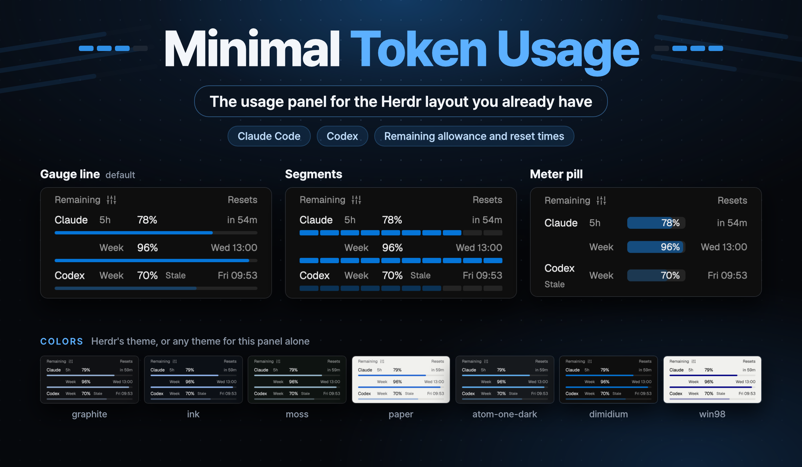

# Minimal Token Usage

The Minimal Token Usage panel (`minimal-token-usage` mod) for the Herdr layout you already have: Claude Code and Codex remaining allowance and reset times, plus one settings window for usage and both accounts.



## Add it

Run `herdr-app check mods/minimal-token-usage` in this folder, then copy `mods/minimal-token-usage/` to `~/.config/herdr-app/mods/minimal-token-usage/`, without `node_modules/`. Check it here, before copying: in Herdr 0.1.16 a panel whose installed folder was checked before its first use stays on `Checking…`. Add this block to a personal layout, for example above the sidebar footer. To change a shipped layout, clone it first. The mod resizes a block given in `px` to fit its rows, up to 180 px.

```json
{"id":"minimal-token-usage","type":"block","size":{"px":92},"content":{"mod":"minimal-token-usage"}}
```

The [Minimal Token Usage layout](../minimal-token-usage/RECIPE.md) already contains this mod, under the same name. With that layout installed, there is nothing to add. Do not add a second copy under another name: the mod refers to itself as `minimal-token-usage`.

For Claude Code, open **Usage settings → Claude account → Connect**. Codex needs no setup. No `keys.json` is needed.

## Panel

A borderless `Week left` header sits over one row per limit: name, remaining percentage and reset time on a text line, and under it a thin bar of remaining allowance that spans the row. The header shows a period only when all reported windows match; mixed periods get a period column. The block grows to fit its rows and scrolls only past 180 px. A narrow slot shows only names and remaining percentages. Colors follow the active theme unless the panel is given its own.

Bars show remaining allowance, and warning and urgent colors mark approaching exhaustion. `Resets` uses local 24-hour times. Expired windows show `--`. A failed refresh keeps the last good value and shows an error; stale reports are marked.

## Settings and accounts

Click the panel or its settings icon to open Usage settings, with three pages: Usage, Claude account, and Codex account. Usage also holds Claude's token totals, alert controls, and Appearance: the bar style (gauge line, segments, or meter pill) and the panel's colors. Colors follow Herdr's theme, or any Herdr theme picked for this panel and its settings window alone; the rest of Herdr keeps its own. Account pages show only fields the provider returns. Login opens the provider's own CLI in a local tab; logout asks for confirmation. Claude account also has Connect and Disconnect for its statusline wrapper.

## Data sources

Claude limits come from the statusline payload after each reply. Connect wraps the existing statusline command and preserves its input and output. The panel shows one Claude account: the one whose session replied last. A session started with its own `CLAUDE_CONFIG_DIR` reports that folder, and the panel, the Claude account page, and Connect then follow it; only that account's sessions count toward the limits. Codex limits come from local session-log events, checked every 15 seconds. The mod does not read credential files or call account usage endpoints. Reports are local snapshots, so after an account change the old limits can remain until the next reply.

## Files

| Path | Role |
|---|---|
| `mods/minimal-token-usage/src/` | TypeScript sources. Herdr runs the generated `.js` files next to them; edit only the sources. |
| `mods/minimal-token-usage/src/types.ts` | `UsageProvider`, `UsageReport`, and the `AccountState` union shared by both providers. |
| `mods/minimal-token-usage/src/main.ts` | The native GPUI view and its commands. |
| `mods/minimal-token-usage/src/reports.ts`, `src/codex.ts` | Claude statusline reports and Codex session-log events, decoded in the mod. |
| `mods/minimal-token-usage/src/system.ts` | The only system commands, for what Herdr's runtime cannot do (file sizes, byte ranges, newest logs): POSIX sh, or PowerShell on Windows. |
| `mods/minimal-token-usage/tap.sh` | Saves each Claude statusline payload with its time, then passes it on. |

Claude Code and Codex are the only providers. Requirements: Herdr and the CLI of each provider you use, on macOS or Linux. A CLI installed with npm under nvm is found there even though it is not on the PATH Herdr runs commands with. No Python, Node or other runtime; the Windows path through PowerShell is not yet tested on Windows. The mod runs local commands and reads Claude settings and transcripts and Codex session logs outside its own folder. Claude Connect changes Claude's CLI settings only after confirmation. Saved Claude reports live under Herdr's `data/minimal-token-usage/`. The shipped JS needs no dependency install.

The complete window with this panel is the [Minimal Token Usage layout](../minimal-token-usage/RECIPE.md).

## Done when

- `herdr-app check mods/minimal-token-usage` passed in this folder before the copy.
- Provider rows show real, locally reported limits and reset times.
- Mixed periods are labeled separately; expired windows show `--`.
- The block fits its rows without a scrollbar; each bar style and color pick in Appearance applies at once.
- Both account pages show the actual sign-in state.
- Claude Connect preserves the existing statusline; Disconnect removes only its wrapper.
- The rest of the layout is unchanged.

A personal fork of PostHog's [Claude usage recipe](https://github.com/PostHog/herdr/blob/main/claude-usage/RECIPE.md), shared under its [MIT license](LICENSE).
