# Minimal Token Usage

[English](README.md) | 한국어

Claude Code와 Codex의 남은 사용량과 초기화 시각을 [Herdr](https://herdr.dev) 사이드바에서 봅니다. Claude Code와 Codex만 지원하며, 다른 agent는 표시하지 않습니다.

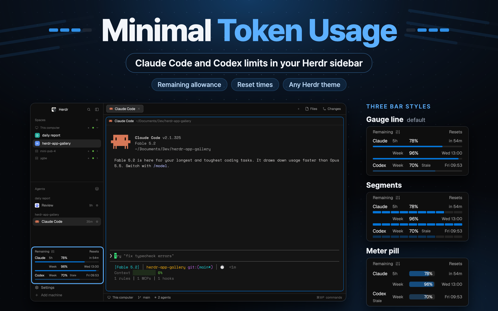

## 설치

macOS 또는 Linux에서 Herdr와 로그인된 Claude Code 또는 Codex CLI가 필요합니다. 그 밖에 설치할 것은 없습니다.

```sh
git clone https://github.com/IamGroooooot/herdr-app-gallery.git
cd herdr-app-gallery/minimal-token-usage
sh install.sh
herdr-app do layout.switch --name Token-usage
```

- **Claude Code**: 패널을 클릭한 뒤 **Usage settings → Claude account → Connect**를 누릅니다.
- **Codex**: 따로 설정할 것이 없습니다.

표시된 값은 Claude Code나 Codex가 응답할 때마다 갱신됩니다.

**업데이트.** 같은 폴더에서 `git pull`을 실행한 뒤 `sh install.sh --replace`를 실행합니다. 설치 스크립트는 교체하는 파일을 백업합니다.

**Windows.** Git Bash에서 설치 스크립트를 실행합니다. 설치 후 mod는 PowerShell로 파일을 읽습니다. 이 경로는 macOS의 PowerShell로 테스트했고, Windows에서는 아직 테스트하지 않았습니다.

layout은 `Token-usage`, mod는 `minimal-token-usage`라는 이름으로 설치됩니다. 쓰던 layout에 패널만 넣으려면 [mod](../minimal-token-usage-mod/RECIPE.md)를 보세요. layout 전체 설명은 [recipe](RECIPE.md)에 있습니다.

## 설정

패널을 클릭하면 **Usage settings**가 열립니다. 고르면 바로 적용되며, 같은 화면 위쪽의 사용량 표시에 결과가 나타납니다.

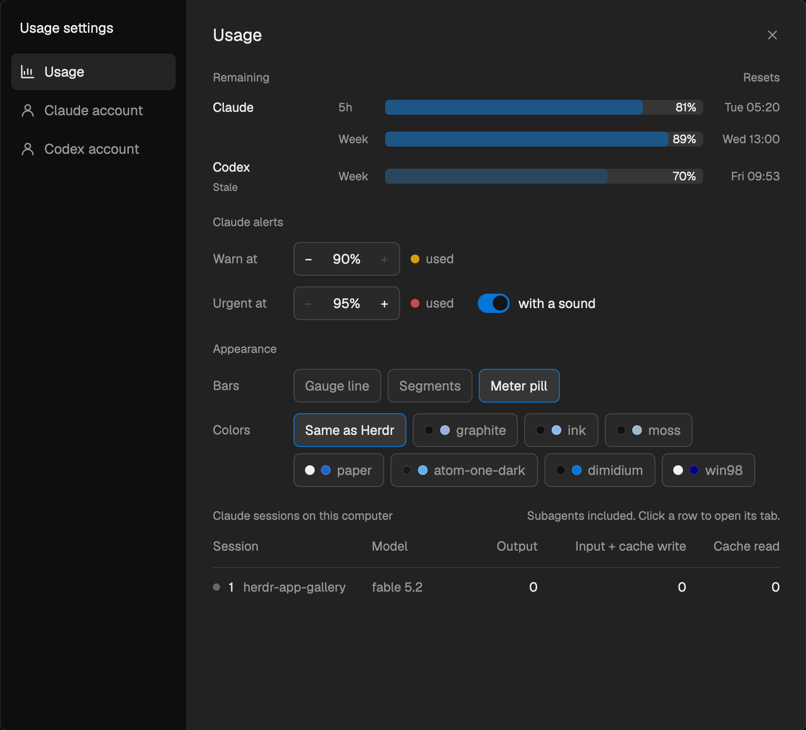

**Alerts.** Claude 사용량이 Warn 기준에 닿으면 Herdr가 알림을 띄우고, Urgent 기준에 닿으면 한 번 더 알립니다. Urgent 알림에는 소리를 켤 수 있습니다.

**Bars.** 남은 사용량을 그리는 방식입니다.

| Gauge line (기본) | Segments | Meter pill |
|---|---|---|
| 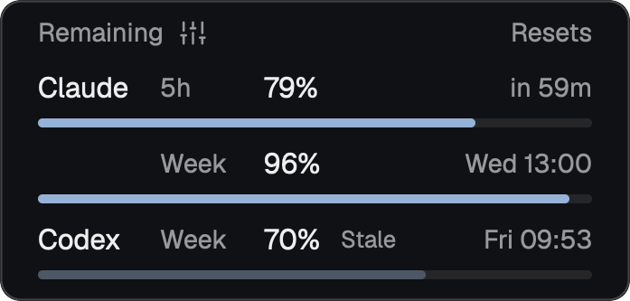 | 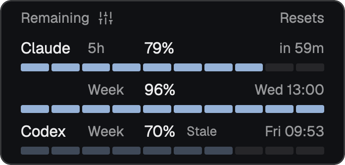 | 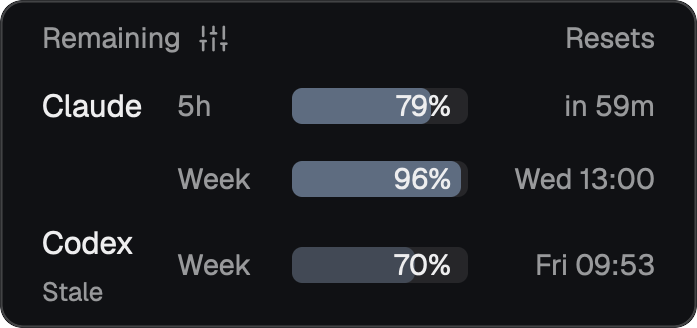 |

**Colors.** 패널은 Herdr의 theme을 따르고, 패널용 theme을 따로 고를 수도 있습니다. 고른 theme은 패널과 설정 창에만 적용되고, Herdr의 나머지는 원래 theme을 유지합니다. Herdr의 `themes/` 폴더에 추가한 theme도 목록에 나옵니다.

| graphite | ink | moss |
|---|---|---|
|  | 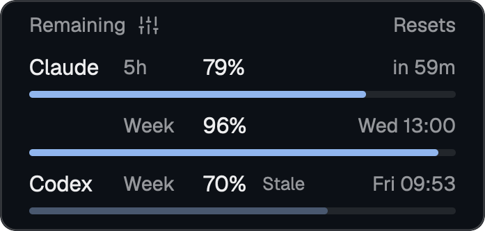 | 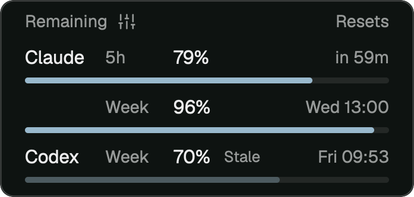 |
| **paper** | **atom-one-dark** | **dimidium** |
| 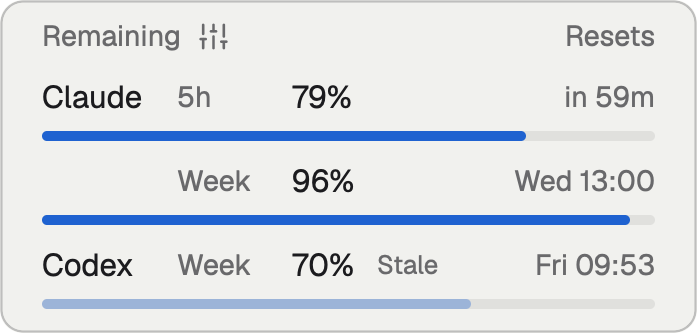 | 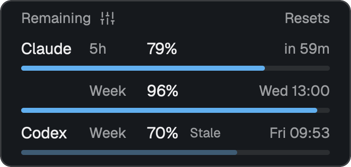 | 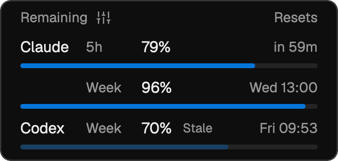 |
| **win98** | | |
| 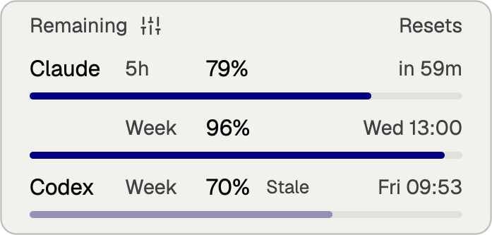 | | |

## 코드 수정

`mods/minimal-token-usage/src/`의 TypeScript를 고칩니다. Herdr는 생성된 `.js` 파일을 실행하므로 `.js`는 직접 고치지 않습니다. Node와 TypeScript는 개발할 때만 필요합니다. `mods/minimal-token-usage/`에서 실행합니다.

```sh
npm ci
npm run verify
```

`verify`는 type check, JS 재생성, 단독 패키지 [minimal-token-usage-mod](../minimal-token-usage-mod/)로의 mod 복사, 테스트, lint, `herdr-app check`를 차례로 실행합니다. lint는 TypeScript와 테스트에 Biome을 쓰고, shellcheck와 shfmt가 설치되어 있으면 shell script도 검사합니다. `npm run format`은 고칠 수 있는 항목을 고칩니다. 테스트는 실제 시스템 명령, `tap.sh`(Claude Code의 사용 한도를 저장하는 스크립트), `install.sh`를 임시 파일을 대상으로, 설치된 모든 shell(`sh`, `dash`, 그리고 `pwsh`로 실행하는 PowerShell)에서 돌립니다. mod의 두 사본이 서로 다르면 테스트가 실패합니다.

- shell은 `src/system.ts`에서만 실행합니다. Herdr의 mod runtime에 없는 기능인 파일 크기 조회, 파일 일부만 읽기, 수정 시각순 정렬, 환경 변수 읽기마다 명령을 하나씩 둡니다. 각 명령은 POSIX sh와 표준 유틸리티만 쓰고, 같은 일을 하는 PowerShell 명령이 따로 있습니다. parsing은 TypeScript에서 합니다.
- 패널이 그리는 내용을 바꿨다면 `herdr-app shot`으로 실행 중인 앱을 보고 `herdr-app status`를 확인합니다.
- push할 때마다 GitHub Actions가 Linux와 macOS에서 테스트와 lint를 실행합니다. busybox 환경은 container로 확인합니다.

```sh
for image in node:22-alpine node:22-slim; do
  docker run --rm -v "$PWD/../..":/src:ro -w /src/mods/minimal-token-usage "$image" \
    sh -c 'node --test tests/*.test.js ../../tests/*.test.js'
done
```

PostHog의 [Claude usage](https://github.com/PostHog/herdr/blob/main/claude-usage/RECIPE.md)를 개인적으로 fork한 것이며, 같은 [MIT license](LICENSE)로 공유합니다.
