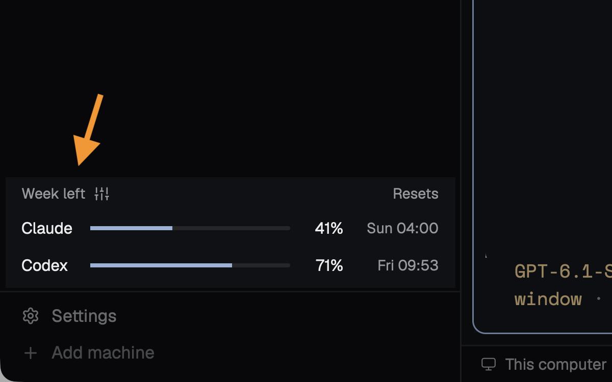

# Token usage

The token-usage panel for the Herdr layout you already have: Claude Code and Codex remaining allowance and reset times, plus one settings window for usage and both accounts.



## Add it

Copy this folder's `mods/token-usage/` to `~/.config/herdr-app/mods/token-usage/`, without `node_modules/`. Add this block to a personal layout, for example above the sidebar footer. To change a shipped layout, clone it first.

```json
{"id":"token-usage","type":"block","size":{"px":92},"content":{"mod":"token-usage"}}
```

For Claude Code, open **Usage settings → Claude account → Connect**. Codex needs no setup. No `keys.json` is needed.

## Panel

A borderless `Week left` header sits over one row per provider: a bar of remaining allowance, the remaining percentage, and the reset time. The header shows a period only when all reported windows match; mixed periods are labeled on their own rows. Extra limits scroll inside the block. A narrow slot shows only names and remaining percentages. Colors follow the active theme.

Bars show remaining allowance, and warning and urgent colors mark approaching exhaustion. `Resets` uses local 24-hour times. Expired windows show `--`. A failed refresh keeps the last good value and shows an error; stale reports are marked.

## Settings and accounts

Click the panel or its settings icon to open Usage settings, with three pages: Usage, Claude account, and Codex account. Usage also holds Claude's token totals and alert controls. Account pages show only fields the provider returns. Login opens the provider's own CLI in a local tab; logout asks for confirmation. Claude account also has Connect and Disconnect for its statusline wrapper.

## Data sources

Claude limits come from the statusline payload after each reply. Connect wraps the existing statusline command and preserves its input and output. Codex limits come from local session-log events, checked every 15 seconds. The mod does not read credential files or call account usage endpoints. Reports are local snapshots, so after an account change the old limits can remain until the next reply.

## Files

| Path | Role |
|---|---|
| `mods/token-usage/src/` | TypeScript sources. Herdr runs the generated `.js` files next to them; edit only the sources. |
| `mods/token-usage/src/types.ts` | `UsageProvider`, `UsageReport`, and the `AccountState` union shared by both providers. |
| `mods/token-usage/src/main.ts` | The native GPUI view and its commands. |
| `mods/token-usage/tap.sh`, `read_*.py` | Claude statusline tap, and Python readers for Claude reports and Codex status and session logs. |

Requirements: macOS or Linux, Python 3, Herdr, and the CLI of each provider you use. The mod runs local commands and reads Claude settings and transcripts and Codex session logs outside its own folder. Claude Connect changes Claude's CLI settings only after confirmation. A sanitized Codex cache lives under Herdr's `data/token-usage/`. The shipped JS needs no dependency install.

The complete window with this panel is the [token-usage layout](../token-usage/RECIPE.md).

## Done when

- `herdr-app check ~/.config/herdr-app/mods/token-usage` passes.
- Provider rows show real, locally reported limits and reset times.
- Mixed periods are labeled separately; expired windows show `--`.
- Both account pages show the actual sign-in state.
- Claude Connect preserves the existing statusline; Disconnect removes only its wrapper.
- The rest of the layout is unchanged.

A personal fork of PostHog's [Claude usage recipe](https://github.com/PostHog/herdr/blob/main/claude-usage/RECIPE.md), shared under its [MIT license](LICENSE).
