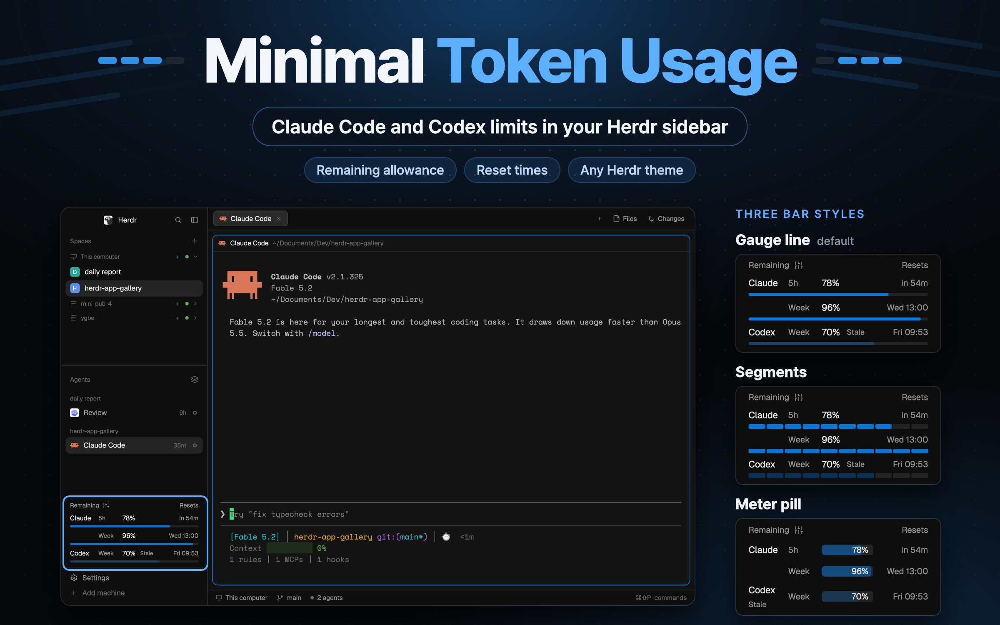
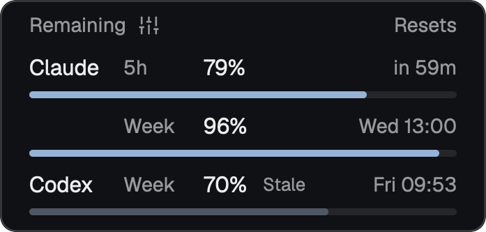
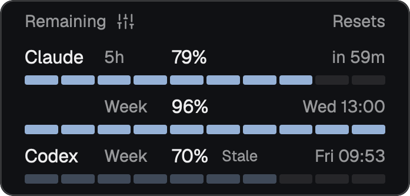
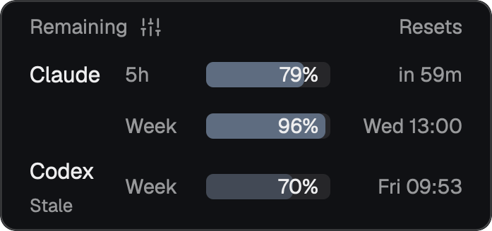
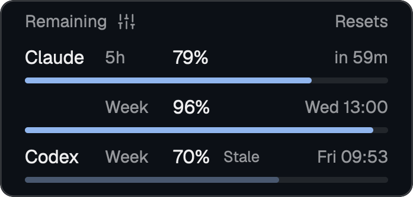
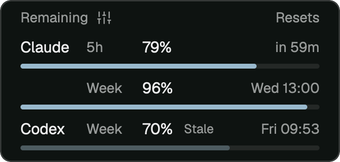
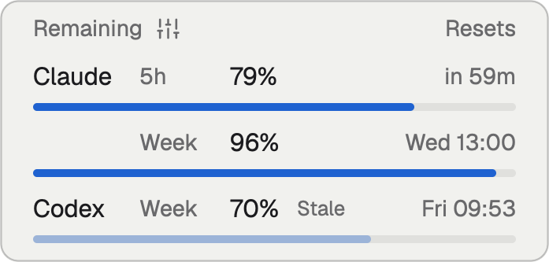
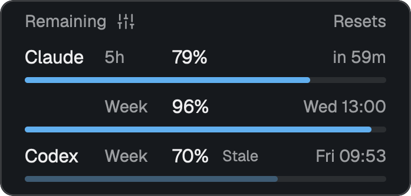
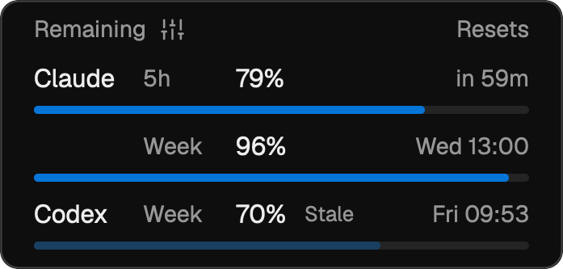
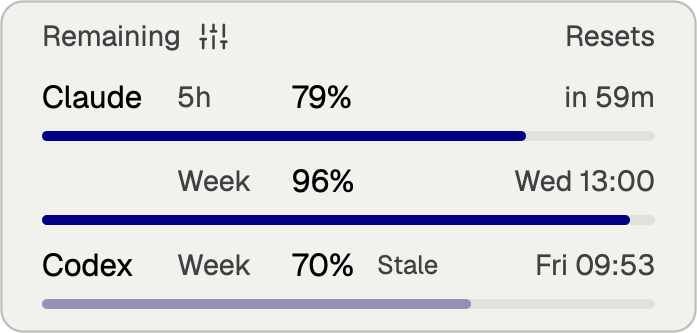

# Minimal Token Usage

English | [한국어](README.ko.md)

See how much Claude Code and Codex allowance you have left, and when it resets, in the [Herdr](https://herdr.dev) sidebar. It supports Claude Code and Codex only; other agents are not shown.



## Install

You need Herdr and a signed-in Claude Code or Codex CLI, on macOS or Linux. There is nothing else to install.

```sh
git clone https://github.com/IamGroooooot/herdr-app-gallery.git
cd herdr-app-gallery/token-usage
sh install.sh
herdr-app do layout.switch --name token-usage
```

- **Claude Code**: click the panel, then **Usage settings → Claude account → Connect**.
- **Codex**: no setup.

The numbers refresh after each Claude Code or Codex reply.

**Update.** Run `git pull`, then `sh install.sh --replace` in the same folder. The installer backs up the files it replaces.

**Windows.** Run the installer from Git Bash. The mod then reads files through PowerShell. This path is tested with PowerShell on macOS, not yet on Windows.

The layout and the mod both install as `token-usage`. To add only the panel to your own layout, see the [mod](../token-usage-mod/RECIPE.md). The [recipe](RECIPE.md) describes the layout in full.

## Appearance

Open **Usage settings → Usage → Appearance**. A choice applies at once, and the limits at the top of that page show the result.

**Bars.** How remaining allowance is drawn.

| Gauge line (default) | Segments | Meter pill |
|---|---|---|
|  |  |  |

**Colors.** The panel follows Herdr's theme unless you pick a theme for it. The theme you pick colors only the panel and its settings window; the rest of Herdr keeps its own theme. Themes you add to Herdr's `themes/` folder are listed too.

| graphite | ink | moss |
|---|---|---|
|  |  |  |
| **paper** | **atom-one-dark** | **dimidium** |
|  |  |  |
| **win98** | | |
|  | | |

## Change the code

Edit the TypeScript in `mods/token-usage/src/`. Herdr runs the generated `.js` files, so never edit those by hand. Node and TypeScript are needed only for development. Run from `mods/token-usage/`:

```sh
npm ci
npm run verify
```

`verify` type-checks, rebuilds the JS, copies the mod into the standalone [token-usage-mod](../token-usage-mod/) package, runs the tests, lints, and runs `herdr-app check`. Lint is Biome for the TypeScript and tests, plus shellcheck and shfmt for the shell scripts when they are installed; `npm run format` applies its fixes. The tests run the real system commands, `tap.sh` (the script that saves Claude Code's limits) and `install.sh` on temporary files under every shell the machine has (`sh`, `dash`, and PowerShell as `pwsh`). They fail while the two copies of the mod differ.

- Only `src/system.ts` starts a shell. It holds one command for each thing Herdr's mod runtime lacks: file size, byte-range read, modification order and environment. Each command uses POSIX sh and standard utilities only and has a PowerShell twin. Parsing stays in TypeScript.
- After changing what the panel draws, look at the running app with `herdr-app shot` and check `herdr-app status`.
- Linux is checked in containers, busybox and GNU:

```sh
for image in node:22-alpine node:22-slim; do
  docker run --rm -v "$PWD/../..":/src:ro -w /src/mods/token-usage "$image" \
    sh -c 'node --test tests/*.test.js ../../tests/*.test.js'
done
```

A personal fork of PostHog's [Claude usage](https://github.com/PostHog/herdr/blob/main/claude-usage/RECIPE.md), shared under its [MIT license](LICENSE).
